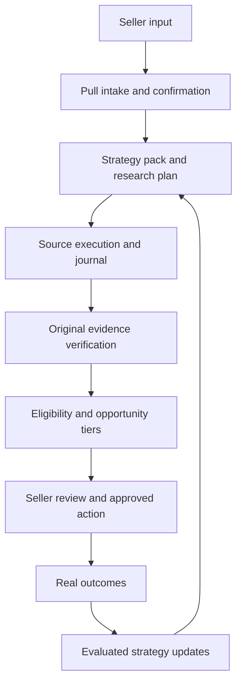

# Pull V2 implementation brief — product to relevant buyer opportunity

Paste the section below into a Codex development session with access to the V2 checkout. This Work Mode checkout is not automatically present on a separate Mac or Codex installation; if the checkout is absent, locate the actual repository and verify the branch and commit before editing. It is an execution brief, not a claim that later phases are complete. Date: 23 October 2026.

Current implementation update: read [PULL-V2-OFFER-FLOW-STATUS.md](PULL-V2-OFFER-FLOW-STATUS.md) before treating any phase below as unimplemented.

---

You are the senior backend and product engineer for Pull GTM V2. Continue from the Pull GTM V2 checkout, branch `v2/product-led-intelligence`. In this Work Mode environment the path is `/workspace/scratch/b02dcc8f71ad/pull-gtm-v2`; on another computer, locate the corresponding checkout first. Inspect actual `git status`, commit history, applicable `AGENTS.md`, current code and tests before editing. Preserve the separate V1 worktree. Do not deploy, touch V1 credentials, migrate a live database or send external messages during this implementation. The latest contract slice is `server/v2-handoff.js`, covered by `tests/v2-handoff.test.mjs`; understand and extend it instead of replacing it. Read `docs/RESEARCH-BACKEND-ARCHITECTURE.md`, `docs/PULL-V2-DEMAND-DISCOVERY-ENGINE.md`, `docs/PULL-V2-IMAGE-TO-BUYER-RESEARCH.md`, `docs/PULL-V2-BUYER-SYSTEMS.md` and `docs/JIJI-INTEGRATION.md`.

`createIntelligenceTools` now accepts an optional server-resolved `confirmedOffer`: the existing search plan takes product, location and exact terms from that record and binds its journal goal to the offer version. This is an internal integration seam, not a live offer endpoint. `server/v2-evaluation.js` computes precision, recall, unknown labels and a Wilson interval from independent annotations; there is no real labelled dataset yet.

## Product job and quality bar

Pull has **zero ready buyers**. A seller may submit a description, image, authorized product listing URL (including a Jiji listing if access is permitted), website, or describe the buyers they think they need. Pull must discover actual demand and routes from available lawful sources, then return only correctly labelled results. The system should work for varied products: a used car, wholesale fabric, a commercial service, equipment, and obscure local items. It must communicate an honest no-result or partial result when necessary.

Our target is **98% precision among surfaced “qualified opportunity” cards on a representative, human-labelled holdout**, subject to sufficient sample size and a reported confidence interval. There is no measured 70% baseline and no evidence of 98% today. Do not claim 98% buyer conversion, 98% recall, or 98% relevance for every product. Define the label in advance: original evidence supports correct product and nonnegotiable terms, current need, relevant geography, actor/role, and a permitted way to engage. Also measure recall/coverage, abstention rate, time to first useful result, source and model cost, positive replies and sales; precision alone can be gamed by showing nothing. Report per category/geography and the overall weighted result, with human disagreement rates.

Interpret the founder's hand-drawn diagram as **Pull intake intelligence → specialized research and verification workers → Pull decision and presentation intelligence → user**, with an outcome loop back to versioned strategies. Codex is the development tool that creates and tests these services; it is not assumed to run inside every user request. A runtime model may be selected via the configured provider only after testing its actual image/tool/schema capabilities. Each transition uses validated, versioned records and durable IDs. No stage accepts a prior model's free-form prose as authoritative facts.

## Required system map



### A. Intake and first Pull layer

Authenticate the owner before any upload, URL inspection or research charge. Accept one or more of `seller_text`, `private_image_asset_id`, `authorized_url` and `buyer_target_hint`. Target hints are proposed hypotheses, never a replacement for product facts. Use `server/v2-handoff.js` as the starting contract and make an immutable offer version only after explicit seller confirmation. Track every field as `seller_stated`, `image_observed`, `page_asserted`, `seller_confirmed` or `externally_verified` with source reference, extraction version and observed time. Contradictory observations remain recorded while the seller chooses the canonical facts.

For private images, validate bytes, size, MIME and ownership; remove unnecessary EXIF; store in a private bucket with retention/deletion. Have a vision-capable model produce schema-constrained observations with an `unknown` route; never infer vehicle year, ownership, condition or selling price from appearance. The model cannot start research or mutate an offer. Use provider transport injection for tests, set cost/time caps, and handle refusal or incomplete output as `needs_review`.

For URLs, allow HTTPS only and do not trust a user-supplied hostname. Resolve and block private, local, metadata and redirected destinations on every hop; cap redirects, bytes, media type and time. Route known platforms through their authorized adapter or a seller-supplied copy/manual entry where fetching is not allowed. Do not add a Jiji scraper or inbox access by default. Preserve the original listing URL and page-asserted facts as source claims. For a seller website, distinguish the business's catalog and testimonials from customer demand.

### B. Category intelligence and strategy packs

Use one core offer schema plus versioned category packs. A pack declares: hard product attributes, buyer jobs, compatible alternatives, disqualifiers, local aliases, typical procurement channels, acceptable source adapters, date windows, seller qualification questions, and expected verification. Begin with `used_vehicle`, `wholesale_material`, `professional_service`, `commercial_equipment`, and `generic`. Keep packs data-driven and test across categories; do not train a separate LLM per category. An unknown category may proceed with a generic pack and must surface the additional uncertainty.

Build a `strategy_plan` from the **confirmed offer ID/version**. The planning model may propose four route classes: `expressed_demand`, `documented_procurement`, `intermediary`, `market_access`. It must justify every route, produce a maximum number of distinct queries with negative terms and local spelling, and identify what evidence would count. The server overwrites model-supplied product/location with the confirmed record and validates query geography, category restrictions, adapter capability and budget. Use `bindResearchPlan` and the existing `buyerResearchInput` validator as starting points. Explicitly distinguish product-exact vs compatible-substitute queries.

### C. Source router and investigation supervisor

Start with existing `server/buyer-research.js`, `server/intelligence.js`, `server/discovery.js` and `server/research-journal.js`: the initial pass has up to four hypotheses, eight source reservations and one bounded refinement. Keep the journal's owner/goal binding, leases, cost reservation, replay and uncertainty semantics. Preserve the three supported configured search providers. Add a registry interface for later permitted adapters: public search, public procurement feeds, seller-connected systems, approved partner data and future opt-in Pull buyer requests. Every adapter advertises supported geography/category, data fields, access rights, rate limits, cost and whether it can open original pages. Search results alone are source candidates.

After the first pass, a deterministic supervisor reads yield, duplication, exact-match rate, coverage, cost and missing proof. It can authorize a bounded second investigation (new run, explicit allowance) where permission exists, choose a new route, or stop with an honest status. Never recursively spend credits until a desired number of leads appears. Closed groups, private comments, inaccessible pages, offline channels and absent sources must create coverage gaps. The user may approve a market-access experiment such as an appropriate listing or dealer approach; a campaign is never recorded as a discovered buyer.

### D. Evidence verification and entity resolution

For each promising source, save `source_observation` with canonical URL/record ID, query, route, excerpt, published claim, fetched time, adapter, permission and content hash. Authorized original-page checks must establish whether a request exists now, who posted it and in what role, precise item/terms, geography, date, status and permitted reply path. Contradictions, missing fields, blocked pages and unavailable originals stay explicit. Never promote a search snippet into original evidence. Treat source text and OCR as untrusted instructions. If an original page changes later, create a new observation version rather than silently rewriting history.

Entity resolution merges exact canonical IDs and robust corroborated identities, but never merges people solely on name, photo, common business name or a similar sentence. Preserve separate request, entity, contact and action records. A public contact address is not necessarily permission for any automation; check source terms and the proposed action route.

### E. Final Pull layer: qualification, reasoning and display

Use deterministic gates for ownership, product and specification fit, location, stock, legal/source eligibility, contact path and current request status. The evaluator is allowed to abstain. `classifyOpportunity` in `server/v2-handoff.js` supplies the first pure boundary; evolve it with checked evidence records so client/model claims cannot impersonate a verifier. Present a `research lead`, `verified request`, `qualified opportunity`, `buying route`, `market access`, `excluded` or `partial/no result` with source links, why it fits, unknowns and next action. A seller listing or a company's product relevance must never appear as a confirmed buyer. The final model only explains checked findings and drafts a reviewable next action; it cannot change tier or send.

The user should see a simple action card: *“One current C300 request needs checking; two dealers handle comparable stock; we could not verify a personal buyer yet.”* Show actual evidence and coverage, with no fabricated count or probabilistic promise. Any outreach, listing, referral or CRM mutation requires a specific approved payload and existing permission rules.

### F. Outcome learning

Record `approved`, `delivered`, `replied`, `qualified_conversation`, `proposal`, `paid`, `fulfilled_sale`, `rejected` and `no_response` separately, with actor, source, time and provenance. A lack of reply is censored until an observation window closes. A click, LLM opinion or page similarity cannot be used as a sale label. Train or tune only after consented, sufficiently diverse outcomes exist. In the interim, use the learning model to propose query synonyms, route choices and pack rule changes; run offline replay and a prospective controlled comparison. Changes are versioned, reviewed and reversible.

## Data and orchestration contracts

Prefer a modular monolith in the existing V2 server plus Postgres/Supabase, using a durable queue/worker only when the synchronous request cannot finish. The browser submits authenticated tasks and receives a `run_id`; it never holds model, source or privileged database keys. Proposed tables: `offer_versions`, `media_assets`, `offer_claims`, `category_pack_versions`, `strategy_plans`, `research_runs` (reuse existing), `source_observations`, `entities`, `opportunities`, `action_approvals`, `outcome_events`, `evaluation_snapshots`. Include tenant ID, visibility, version, source/provenance, retention and indexes appropriate to access paths. Do not materialize a free-form mega-JSON document as the sole source of truth. Any database migration must be isolated to V2 and tested locally/staging before live use; review RLS, grants and security-definer functions, and never leak service credentials to the browser.

Example stage envelope; the server validates every version before handing it to a worker:

```json
{
  "schema_version": 1,
  "run_id": "uuid",
  "owner_id": "auth-bound-id",
  "offer_id": "uuid",
  "offer_version": 1,
  "stage": "verify_source",
  "input_refs": ["source-observation-id"],
  "policy_version": "category-pack-v1",
  "budget_reservation_id": "reservation-id",
  "idempotency_key": "stable-stage-key"
}
```

Workers claim a lease, load only authorized records, enforce the budget, write a typed result and append an immutable receipt. Return `uncertain` on an ambiguous third-party completion. A queue delivery guarantee does not mean exactly-once external search, payment or messaging. Add a status API and cancellation with explicit partial results. The current journal protects source search; expand only when real asynchronous work requires it.

## Execution sequence and acceptance gates

1. **Inspect and baseline.** Confirm the exact branch, V2 boundary, auth path, feature flags, existing SQL status and current test count. Record what is live vs local-only. Run `npm run check` and `npm test` on the unmodified head; resolve any failures without weakening production validation.
2. **Offer contract and first working path.** Extend `server/v2-handoff.js` into an authenticated text/URL intake endpoint using owner-scoped records, category pack selection and a confirmed offer version. Bind model research to the confirmed offer. Write fixture-based HTTP and validation tests, including changed location, product model, stale offer version and cross-owner access. This phase must work before vision is added.
3. **Source evidence.** Add one authorized original-page adapter and original-source checker with URL safety, source status and clear abstention. Test active request, seller listing, closed request, wrong model, unreachable source, contradictory details and a valid intermediary. No candidate can pass the qualified gate using snippets alone.
4. **Image intake.** Add private upload + vision extraction to the same offer contract. Validate low-quality images, conflicting seller text, multiple objects, OCR prompt injection, mistaken trim/year and category ambiguity. An image-only draft should pause for seller confirmation.
5. **Adaptive and category coverage.** Add strategy packs and coverage-aware route choice. Test used car in Lagos and Abuja, wholesale fabric in Kano, service in Lagos/Abuja, and at least one obscure product. Include zero-result cases. Expand provider types only with authorization and measured value.
6. **Asynchronous execution and actions.** Add a durable worker and progress API if the preceding path exceeds the request window. Require permission gates before any outbound workflow. Test crash/replay, concurrent reservation, quota exhaustion, cancellation, repeated click and tenant isolation on real Postgres/staging; PGlite single-connection checks alone do not establish races.
7. **Evaluation.** Create an independently labelled holdout and baseline from the current search, adjudicate disagreements, extend `server/v2-evaluation.js` where necessary, and report precision and confidence interval with recall/coverage and cost. Do not label or advertise 98% until the measured gate is met on representative categories and geographies. Gate rollout behind V2 flags and review staging credentials/configuration independently.

Do the implementation in reviewable commits. For each phase, report changed files, one real end-to-end example, relevant test results, known coverage gaps and the next dependency. Never claim a live buyer, successful contact, source verification, model accuracy or deployed feature from synthetic tests. No deployment or external account action is authorized by this brief.

## Reference points already inspected

- Official image analysis: https://developers.openai.com/api/docs/guides/images-vision
- Official structured output capabilities and limitations: https://developers.openai.com/api/docs/guides/structured-outputs
- Supabase Queue and hybrid retrieval documentation: https://supabase.com/docs/guides/queues and https://supabase.com/docs/guides/ai/hybrid-search
- Current repository behaviour: `server/buyer-research.js` (bounded source discovery), `server/research-journal.js` (durable source reservations), `server/v2-handoff.js` (offer provenance and buyer tier contract).
