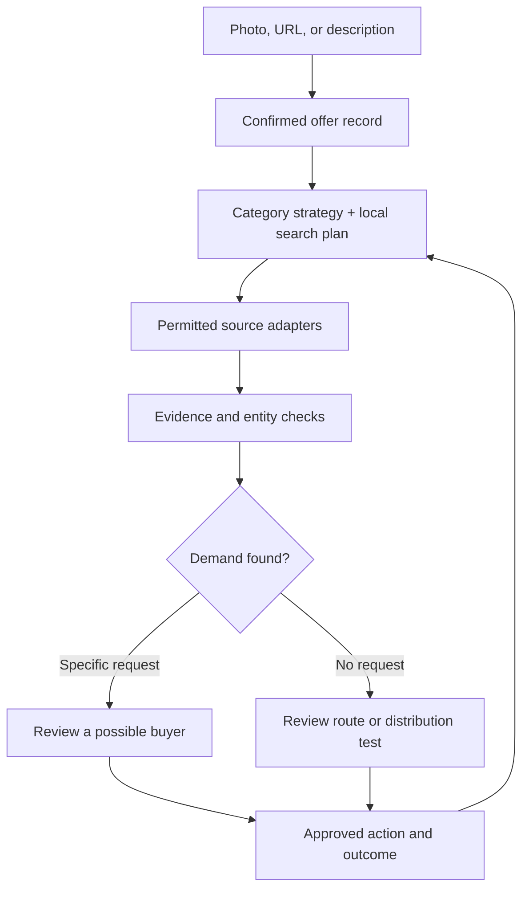

# Pull V2: product-to-demand discovery engine

23 October 2026. Proposed backend design on the isolated V2 branch. **Pull has no ready buyer database, no live product-photo intake, no semantic buyer-request verifier, and no outcome-trained ranker.** Saved-offer binding and bounded original-page observations are now locally implemented; see `PULL-V2-OFFER-FLOW-STATUS.md` for enablement and verification limits. The current implementation has a bounded search/journal that returns possible requests, buying routes and market context from search excerpts. This document specifies how to extend it. It makes no guarantee of buyers or sales.

The staged engineering handoff, including the first implemented server contracts and evaluation method, is in [PULL-V2-CODEX-IMPLEMENTATION-BRIEF.md](PULL-V2-CODEX-IMPLEMENTATION-BRIEF.md).

## The product promise and the actual mechanism

A seller supplies a product photo, a listing URL, a website, or a plain description. Pull turns it into a confirmed commercial offer, searches for *evidence of demand* and *ways to reach a relevant market*, checks each candidate, and proposes a next action. For a product that has no public request, Pull can offer a suitable intermediary or a seller-approved distribution test. It must show `no verified buyer found` when that is the finding. A seller listing, a like, a web visit, a category match and a company that could use a product do not establish a willing buyer.

The screenshots of Ehira and Lookaround supplied on 23 October show offer or website intake and product-prompt intake. Ehira's displayed 148 contacted / 15 replies / 10 buyers is its own reported result, not a verified benchmark for Pull. Our goal is measurable results from actual source review, qualified conversations and transactions, not replicating their UI or claiming superiority from their marketing.

## 1. One offer contract, many input types

Normalize every input into `{offer_id, owner_id, category, subtype, exact_attributes, use_cases, price_or_terms, stock_or_capacity, geography, fulfilment, trust_proof, restrictions, confirmed_at, version}`. A photo can propose visually observable attributes; a URL can supply page text; a description is seller-stated. Every attribute stores its source (`image_observed`, `page_asserted`, `seller_confirmed`, `external_verified`), time and uncertainty. Require the seller to confirm facts that change matching, especially exact variant, location, price, condition, quantity, service capacity and delivery. A listing URL must be fetched only through a guarded adapter with an allowlisted scheme, safe DNS/IP resolution and response-size/content limits; respect the site and do not assume link access gives scraping or messaging rights.

The core schema stays small. Category strategy packs add typed attributes and buying rules. A pack declares required fields, compatible substitutes, buyer jobs, disqualifiers, permitted source routes, geography expansion rules, qualification questions and freshness windows. Packs are **configuration and evaluation sets**, not a different trained model for each product. Unrecognized products use a generic pack, with explicit unknowns and less confident suggestions. Never use a pack to guess a stranger's wealth from appearance or interests.

| Example | Fields that change matching | Places demand may be observable | Route if no direct request |
| --- | --- | --- | --- |
| Used C300 in Lagos | Year, trim, condition, documents, price, inspection and delivery area | Explicit vehicle requests and opted-in buyer briefs | Verified dealers who accept that model and price range; seller-approved placement |
| Cotton fabric wholesale | Composition, GSM, MOQ, certification, price, lead time, shipping | Private-sector RFQs and importer requirements | Qualified mills, converters, distributors and trade associations |
| Brand identity service | Scope, proof of past work, budget band, timeline, market | Commercial project briefs and opt-in referrals | Agencies and partner networks accepting specialist work |
| Cold-chain equipment | Capacity, temperature range, installation, service coverage | Private procurement notices, expansion projects, buyer inquiries | Installers, integrators and resellers qualified for the specification |

These are **search hypotheses**, not assertions that the named markets contain active buyers.

## 2. Research creates demand evidence, not an invented buyer pool

The planner gets the confirmed offer and a category pack. It generates a small portfolio of hypotheses across four independently labelled routes:

1. **Expressed demand:** a current person or business openly requests the specific item, service or compatible substitute.
2. **Documented procurement:** an authorized private-sector RFQ or buyer requirement with product, geography, deadline and conditions. The current product policy excludes government and public institutions as prospects and sources; government tenders are out of scope unless that policy is deliberately changed.
3. **Intermediary or likely user:** a dealer, distributor or business whose verified role makes it reasonable to ask if they buy or refer this item; demand remains unknown.
4. **Market access:** a reachable community, partner channel, listing or campaign where the seller may invite relevant people to respond; this is a distribution opportunity, not a buyer.

Each plan specifies exact and alternate product vocabulary, negative terms, target language, location, source adapter, reason for the search, cost limit and required proof. Research covers local spelling and category language, but never silently broadens the seller's geography or claims a substitute fits when a hard requirement differs. Route diversity matters more than generating hundreds of synonymous queries.

The **source router** chooses from registered adapters with capabilities and permissions: existing Brave/Exa/Serper search, authorized public pages, approved private procurement feeds, seller-connected CRM or storefront data, and later opt-in Pull buyer requests. Each adapter declares accessible fields, allowed retention, rate limits, freshness, and whether original content and a contact path can be checked. Some local demand will exist only in offline or closed channels. In that case Pull can recommend a human or partner route, not pretend to have searched private conversations.

The existing `server/buyer-research.js` is the first bounded pass: at most four hypotheses and eight source reservations per investigation with a journal. Treat its snippets as **candidate discovery only**. A later asynchronous investigation can allocate a new explicitly authorized budget to the most promising and uncovered routes, preserving the original journal's reservation and replay semantics; do not turn the eight-query cap off to create an impression of depth.

## 3. Evidence pipeline and decision gate

For every candidate, create a source observation: canonical URL or authorized record ID, excerpt, discovery query, source type, observed time and exact product attributes mentioned. Fetch original material through a permitted adapter when available. Check whether the request still exists, was authored by a buyer rather than a seller, has a plausible date, is in the requested market, matches nonnegotiable specifications, and offers a permitted contact path. Preserve contradictions and missing data. Deduplicate by canonical request or organization, never by name or image alone. Keep private source text out of public output.

Result tiers have different words and privileges:

| Tier | Minimum evidence | Seller sees | Permitted next step |
| --- | --- | --- | --- |
| Research lead | Search excerpt only | Source to check | Open and inspect |
| Verified request | Original active request checked; key specs and author/role supported | Possible buyer request | Ask seller to review conditions |
| Qualified opportunity | Fit confirmed plus current need and allowed contact route, or buyer opted in | Relevant buyer opportunity | Prepare contact or introduction for approval |
| Buying route | Original business activity and product fit checked; intent unknown | Dealer, distributor or partner to approach | Ask whether they buy or refer |
| Market access | A legitimate, reachable channel with a relevant audience | Place to test the offer | Seller approves a listing, partner approach or campaign |

Hard constraints reject incompatible specs, unavailable stock, prohibited contact, closed requests and geography conflicts before any model ranking. A model explains softer fit, open questions and the next low-cost verification step. A numeric fit score, if shown later, is calibrated against labelled results and carries a clear definition; it is never a purchase probability.

## 4. Adaptive investigation with an honest stop condition

The first pass samples distinct routes. Its result can be `qualified`, `promising but unverified`, `route only`, `no useful evidence`, or `partial`. A supervisor considers the source yield, duplicates, unresolved critical attributes, remaining budget and category-specific coverage. If a verified request appears, prioritize checking it. If snippets are noisy, switch vocabulary or source type once. If direct demand is absent, spend a bounded pass on suitable intermediaries or market access. Stop when additional research is unlikely to improve value within the seller's allowance, an adapter fails, consent is missing, or coverage is exhausted. Report exactly what was searched and what was not.

Do not make a fixed list of ten names the success condition. For a rare, expensive product, one current request or one excellent acquisition partner is more useful than twenty topical pages. For a commodity product, a verified purchasing channel may produce more conversations than a speculative individual list. If there is no searchable demand, the proposed seller-approved distribution test should name the target market, offer, channel, expected cost, success metric and observation window; results are measured after real responses.

## 5. Concrete backend boundaries

Keep the authenticated V2 server as the policy boundary and PostgreSQL as the source of truth. Store images privately. Persist `offer_versions`, `category_pack_versions`, `research_runs`, `search_plans`, `source_observations`, `entities`, `opportunities`, `approved_actions` and `outcome_events` with owner/visibility rules and immutable provenance. The research journal already persists source reservations, leases and receipts. Extend it through versioned, isolated tables or services; do not grant the model direct database, web scraping, send or budget authority.

Use a durable queue for stage tasks when moving beyond one request: `extract_offer`, `plan_routes`, `search_source`, `verify_candidate`, `qualify`, `propose_action` and `summarize_outcomes`. Workers receive IDs, versioned inputs and cost reservations, produce typed outputs, and checkpoint. A crash can resume completed receipts; an ambiguous external call is marked uncertain instead of automatically charging or contacting twice. The current Supabase Queues offering provides a Postgres-backed message queue, but application-level idempotency and provider-side confirmation are still required for external work. Queue adoption needs staging verification in this project. See official documentation: https://supabase.com/docs/guides/queues .

Every user-facing read passes the authenticated owner boundary. New exposed tables need explicit API grants plus RLS where intended; private worker tables stay unexposed. Signed, short-lived media access, deletion, source licensing and retention apply before search or model use. Scheduled learning sees only consented outcomes. It can propose new category vocabulary or ranking weights; evaluation on held-out examples and a separate promotion step decide whether a change goes live.

## 6. Build order and proof of value

1. **One narrow vertical:** seller-confirmed offer from text or an authorized listing URL → varied hypotheses → existing journaled search → original-page verification → correctly labelled opportunity or explicit no result. Cars in Lagos/Abuja provide a test case, but also test a service and a wholesale item to prevent car-specific logic from posing as universal.
2. **Photo intake:** add vision extraction with attribute provenance and seller confirmation. It feeds the same offer contract as the text path. Evaluate attribute accuracy by category before trusting it to launch research.
3. **New route types:** approved procurement and partner adapters, evidence checks, resumable worker and coverage-aware expansion. Introduce opt-in buyer requests only after there are willing buyers and a matching consent design.
4. **Activation and learning:** seller-approved action tracking; record delivered messages, genuine replies, qualified conversations and fulfilled sales separately. Run controlled tests of category packs and route ranking against a stable baseline.

The launch evaluation should use a human-labelled sample across categories and localities. Measure original-source verification precision, relevant opportunities per investigated offer, time and cost to first useful result, percentage with no result, false buyer claims, approved action rate, qualified conversation rate and eventual sales where observed. Compare against the current bounded search and a manual researcher. Only then can Pull substantiate being better than Ehira, Lookaround or any other product for a specified market.
