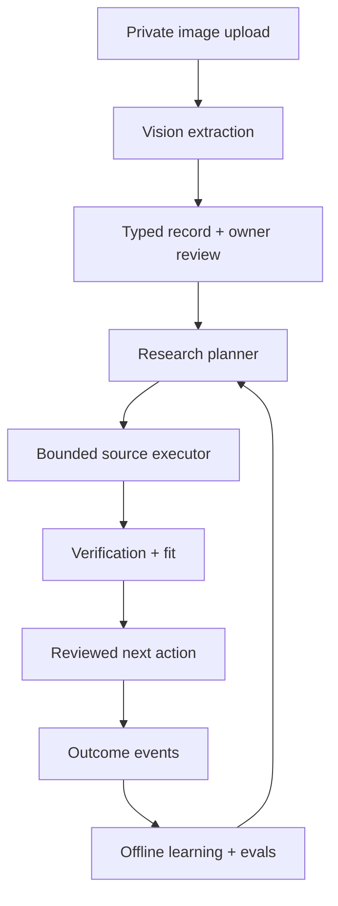

# Pull V2: image to buyer research and learning

23 October 2026. Architecture proposal for the isolated V2 branch. No image upload, vision model call, vector index or learning worker has been implemented or deployed by this document. The current bounded product-led research and durable journal are the starting point.

The cross-category research strategy, including how to return useful routes when no buyer request exists, is specified in [PULL-V2-DEMAND-DISCOVERY-ENGINE.md](PULL-V2-DEMAND-DISCOVERY-ENGINE.md). Pull has no pre-existing buyer pool.

## Product job

The person chooses **“I’m selling this”** or **“I’m looking for this”**, uploads a photo, and adds what they know. Pull extracts visible details, asks about consequential unknowns, builds an owner-confirmed offer or request, investigates permissible buying routes, checks sources, proposes a relevant next action, and learns from genuine responses. A photo is a clue. It cannot prove price, authenticity, ownership, model year, condition, budget or purchase intent.

## One orchestrator, specialized stages

**Vision worker.** A vision-capable model reads the uploaded image plus the owner's description and returns strict structured JSON: visible text, category, candidate product attributes, visual uncertainty and missing fields. Its instruction is to separate `visible`, `seller_stated`, `buyer_stated` and `inferred` claims. It cannot call search, mutate inventory or certify facts. A refusal or incomplete output becomes a review task. OpenAI's Responses API accepts image inputs, and Structured Outputs can constrain the JSON shape; this is API capability, not proof of extraction accuracy. https://developers.openai.com/api/docs/guides/images-vision and https://developers.openai.com/api/docs/guides/structured-outputs .

**Pull normalization.** Server validation applies category rules, strips unsupported claims, retains claim provenance, and asks the owner to confirm exact specs, price, location, stock/quantity, delivery and any required proof. Saving produces an immutable `offer_version` or `request_version`. If the same photo is used by someone else, ownership and intent remain independent; image similarity never merges accounts.

**Search planner.** A task-specific prompt reads only the confirmed record, relevant category checklist, permitted geography and budget. It proposes distinct expressed-demand, intermediary and market-context routes in the current `discover_buyer_routes` contract. Buyer requests within Pull can be another authorized route later. The planner cannot change the confirmed product or spend a source credit.

**Executor and evidence.** The existing V2 source executor validates queries, spends the bounded source allowance and journals receipts. A future original-page checker will use source-specific, authorized adapters; it will preserve original URLs, checked time and contradictory claims. A source snippet remains unverified. A photo of a car and an online comment about a car do not together create a verified buyer.

**Fit and next action.** Deterministic gates enforce exact spec, location, availability, stated budget, role and contact eligibility. A reasoning model can explain trade-offs and draft a question, but cannot change those gates or send. Results distinguish `research source`, `seller-checked route`, `buyer-request match`, `named contact`, `approved action` and `sale`. The owner approves a specific action with the existing permission architecture.

**Learning stage.** The so-called “next learning LLM” is a bounded analyst of labelled events, not a model that trains itself from every upload. It may cluster real objections and propose new search vocabulary or category rules. A separate evaluator compares proposed changes against held-out, human-reviewed examples and observed qualified conversations. Only approved, versioned changes affect the planner or ranking weights. A click, image resemblance or model guess is never a positive sale label. A true fine-tune can be considered only after consented data, volume, evaluation and a measured advantage justify it.

## Typed handoff contracts

| Record | Essential fields | Truth boundary |
| --- | --- | --- |
| `media_asset` | Owner, SHA-256, private storage key, MIME and byte size, uploaded time, purpose, retention | The original image is stored privately; do not send a public URL to a model. |
| `visual_observation` | Asset ID, observed label/text, location in image if supported, model/version, source type, uncertainty | A visible badge or caption is image evidence, not certified manufacturer/model/year. |
| `offer` / `buyer_request` | Owner, version, category, exact spec, price/budget if stated, location, constraints, asset refs, confirmation time | Buyer budget is voluntary; seller price/stock are seller assertions. |
| `research_run` | Owner, record version, validated hypotheses, allowance, lease, checkpoints | Editing the offer/request cannot silently rebind an old run. |
| `source_observation` | URL, excerpt, query, observed time, original-page check state, claim refs | Source publication time is source-asserted until checked. |
| `match` | Offer/request IDs, exact constraints, explanation, gaps, evidence refs | Embedding similarity is candidate retrieval, never eligibility. |
| `action` | Owner, destination, exact payload digest, permission, approval, reservation, receipt | Authorization to research differs from authorization to contact. |
| `outcome_event` | Offer/request/match/action IDs, type, provenance, time, amount if truly observed | Reply, qualified conversation, payment and fulfilled sale are separate. |
| `learning_snapshot` | Dataset window, labels, prompt/ranker version, metrics, reviewer, rollback version | No automatic promotion of a new rule from model-generated feedback. |

## Backend shape in this repository

Keep the current server as the authenticated API and policy boundary. Add `POST /v2/media` for a private upload reservation, `POST /v2/observations` to start extraction, `PATCH /v2/records/:id` for owner correction and confirmation, and `POST /v2/research-runs` for a confirmed record version. Return a run ID immediately and expose `GET /v2/runs/:id` for resumable status. The client never supplies a different owner's asset ID or calls the model, provider, research journal or database RPC directly. Every handler checks the session, owner and V2 feature flag.

Use Supabase private object storage for the photo and PostgreSQL for the typed records, run state, step receipts and audit events. A small leased worker can process `extract_image`, `plan_research`, `check_source`, `rank_match` and `analyze_outcomes` tasks. Start with the existing `createResearchJournal` and `discover_buyer_routes` path for research, retaining its limits and goal fingerprint; do not replace its source ledger with model memory. Separate privileged worker credentials from the public API and require database constraints plus owner policies for all new tables.

Each task accepts immutable IDs and a schema version, then writes a validated output ID. For example, the vision worker receives `{asset_id, purpose, owner_description, extraction_schema_version}` and writes `visual_observation_id`; confirmation writes `record_version_id`; the research worker receives `{record_version_id, run_id, allowance}` and writes evidence IDs. Pass references and short typed summaries between workers, not an accumulating transcript. Persist `prompt_version`, `model`, input/output digests, cost and failure state for reproducibility without storing unnecessary personal information in logs.

The learning worker reads only consented, access-controlled outcome events in a scheduled batch. Its output is a candidate configuration version and an evaluation report. Promotion is a separate privileged operation after review. That is the feedback loop which improves Pull over time without letting an LLM rewrite production code or reclassify its own guesses as successful sales.

## How “embedded in Pull” should work

The canonical product and request data stays in PostgreSQL with owner-scoped policies. After confirmation, form a compact text representation of the *confirmed* attributes and, only if retrieval quality warrants it, create a text embedding for candidate matching. Use exact identifiers and filters first (model, year, quantity, geography, availability); combine keyword and vector retrieval for semantically related use cases; then apply hard eligibility rules. Embeddings represent textual relatedness, not trust, ownership or buying intent. Keep vectors tied to owner/visibility permissions and a version so edits invalidate the right candidates. OpenAI documents text embeddings for similarity/search; Supabase documents PostgreSQL full-text plus pgvector hybrid retrieval. https://developers.openai.com/api/docs/guides/embeddings and https://supabase.com/docs/guides/ai/hybrid-search .

Do not push raw images into a vector index just because they are images. A text embedding model embeds **text**, not image pixels. If later tests show an image-to-image match adds value, evaluate a compatible multimodal embedding model with a separate index and quality benchmark. Keep the owner-confirmed product facts authoritative in either case.

## Durable execution and budgets

The current V2 chat investigation has a bounded synchronous window. Vision + owner correction + search + source verification + learning cannot fit honestly in one request. Use a durable run with `uploaded → extracting → needs_review → confirmed → researching → needs_source_review → ready_for_action → completed`, plus `failed`, `cancelled` and `partial`. The browser can resume by run ID. Each external step has an idempotency key, lease, reserved cost and immutable receipt. Worker crashes preserve prior results; ambiguous provider completions are marked uncertain rather than silently retried. Retain the existing research journal semantics and add an asynchronous worker only when the first slice requires it.

Do one bounded vision call first. Re-analyze only a low-quality image or a seller-corrected ambiguity when the owner chooses to spend another allowance. Do not chain five costly models by default. The research allowance, model budget and storage quota are owner- and project-scoped. Capture latency and cost by stage.

## Example: seller's C300 photo

The image may show a Mercedes grille and a `C300` badge. Pull records those as visible observations, with uncertainty about model year, trim, ownership, condition and selling price. The seller confirms `2026 C300`, Lagos, asking price, documents and inspection area. Pull then searches for exact requests and appropriate dealers under the existing limits. A dealer page becomes a possible business route; a public “I love this car” comment stays market context. If an opted-in buyer request matches year, budget and pickup constraints, Pull explains the fit and asks both sides before an introduction. A real reply or transaction updates the outcome ledger; the learning stage may later improve route priority from accumulated labelled results.

## First implementation slice

1. Create private, owner-scoped image intake with file-type/size inspection, content hash, deletion and purpose-specific consent to send to the model.
2. Add one strict vision extraction schema and server validator for `offer` and `buyer_request`; create an editable confirmation card. Test with conflicting text, low-quality photos and product categories beyond cars.
3. Persist confirmed versions and connect the seller-offer path to the current bounded buyer research. Keep research sources and contacts separate. Add the buyer-request path only after request permissions and matching review exist.
4. Evaluate extraction against labelled photos: attribute precision by category, unknown-field rate, false claims and correction time. Evaluate match precision and actual conversations separately. Release behind a V2 flag; V1 and live credentials stay untouched.

Security: authenticate before upload or lookup; tenant RLS; signed, short-lived private media access; remove unnecessary EXIF; inspect file bytes rather than trusting extension; bound image/model cost; treat OCR and third-party pages as untrusted instructions; redact personal details before optional embedding; enforce deletion and retention. The model receives only the minimal authorized record. These are release requirements, not claims that this branch already implements them.
