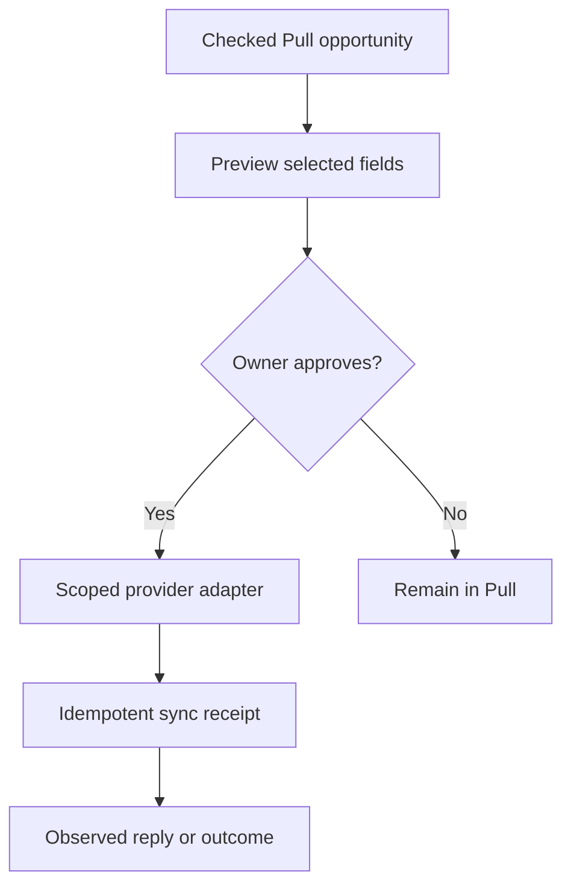

# Pull V2 integration companion

23 October 2026. Local design and contract work only. These two lemlist screenshots were reviewed in the conversation: an integration marketplace showing CRM connections and an AI provider area showing bring-your-own-key and lemlist MCP entry points. This is a small support layer for Pull's buyer intelligence, not a new outreach product.

## What the screenshots establish

The UI presents separate tabs for Integrations Marketplace, API & Webhooks and BCC; AI providers such as Claude, OpenAI, Perplexity, Grok and Gemini; a choice between an AI-provider API key and adding lemlist's MCP to an assistant; and CRM entries for Salesforce, Pipedrive, HubSpot and Zoho. “Connect” and “Install” are visible actions. A screenshot does not establish granted scopes, active connections, sync direction, encryption, webhook verification, or lemlist's private backend architecture. We have not inspected their source or infrastructure.

Lemlist's published documents describe several *observable contracts*: CRM field mapping, ownership mapping, activity selection and sync logs; OAuth or API-key MCP access with confirmation for mutating/credit-consuming tools; reusable company context; and a Basic-auth public API with rate limits. Those behaviors suggest a backend with authorization, provider adapters, mapping, jobs and logs, but that topology is an **inference**, not a claim about lemlist's actual implementation. Sources: https://help.lemlist.com/en/articles/10308771-how-to-configure-the-hubspot-integration-in-lemlist ; https://help.lemlist.com/en/articles/15565943-lemlist-mcp-full-tools-reference ; https://help.lemlist.com/en/articles/13727799-ai-context-center-in-lemlist-how-it-works ; https://developer.lemlist.com/api-reference/getting-started/authentication ; https://developer.lemlist.com/api-reference/getting-started/rate-limits .

## Pull's 2% addition

Pull owns offer understanding, buyer-route research, original-source review, fit, truthful decision support and measured outcomes. Integrations move a **seller-approved, checked opportunity** into an existing CRM or inbox and return a reply or outcome. The integration is invoked at the point of an actual job; there is no need for a large marketplace in the main navigation.

| Pull job | First integration | Precise capability | Not granted by connection alone |
| --- | --- | --- | --- |
| Seller checks a business buying route | HubSpot or Pipedrive, one pilot adapter first | Preview and explicitly export a reviewed route as a task/note or mapped business opportunity | Create a named contact from a search snippet; enroll anyone in a sequence |
| Seller sent an approved Gmail message and receives a reply | Separate Gmail read authorization, later phase | Observe replies linked to a Pull delivery receipt and stop follow-up | Read every mailbox message by default; infer a sale from a reply |
| Seller uses an external AI assistant | Existing Pull MCP capability, later refine | Read bounded opportunity summaries and draft/review plans | Run arbitrary provider tools, spend research credits, or send without explicit approval |
| Seller wants their own model account | Optional BYOK after outcome loop | Route selected tasks through a server-held, scoped provider credential and show costs | Share provider key with browser, model prompts or CRM |
| Seller wants another system notified | Signed outbound webhook after pilot | Send selected, owner-approved outcome events with retries and replay handling | Broadcast raw source excerpts or tokens to arbitrary URLs |

The **first** integration slice is CRM handoff of a seller-reviewed business route. It needs no email sending and can be prepared with the existing source-card shape. The module `server/integration-handoff.js` creates a bounded, deterministic preview and checks that the review belongs to the authenticated owner and refers to the same original source. It deliberately performs no network call or database write. Actual export awaits the opportunity review store, provider connection, field mapping and the seller's approval of the exact record.

## Backend contract to build toward

The account connection, the right to read a reply, the right to write a CRM record, and the approval of **one exact export** are four separate decisions. A connected identity is not a sending grant. Pull's current Gmail and X connection vault already enforces owner-scoped credentials and individual send reservations; reuse its security patterns rather than adding a second hidden sending path. Its Gmail scope currently permits sending, not reading; reply sync would require new consent and a separate Google API review. Gmail push uses Pub/Sub, history IDs and watch renewal, with a catch-up path for missed notifications: https://developers.google.com/workspace/gmail/api/guides/push and https://developers.google.com/workspace/gmail/api/guides/sync .

### Persisted state, when provider access exists

- `integration_connections`: owner, provider, provider account, granted scopes, sealed token, expiration, revocation and connection revision. Unique by owner/provider/account. Server-only token access through a purpose-bound capability; reconnect on missing rights.
- `integration_grants`: owner, connection, permitted object types and operations; explicit on/off, revocation time. External OAuth scopes are only the outer limit.
- `integration_mappings`: provider object type, Pull event field allowlist, destination property, one-way direction and version. Default is **Pull reviewed route → CRM note/task**, never bidirectional contact overwrite.
- `integration_jobs`: owner, offer/version, source key, provider account, action, preview digest, idempotency key, approval ID, status, attempt count, safe error code, provider receipt and timestamps. Keep unknown outcomes uncertain; do not retry a possible write blindly.
- `integration_events`: verified provider webhook identity, provider event ID, owner, connection, normalized event, observed time and deduplication key. Return only minimal fields needed for replies or outcomes; no automatic sales inference.

Each row uses tenant RLS; the client cannot read ciphertext, write receipts or invent webhook events. The adapter accepts a typed action and fixed provider base URL, validates the token/account/scope just before sending, and records a reservation before an external write. Secrets never enter an LLM prompt. The model can propose an action but cannot execute it. A disconnect revokes future use and scrubs the token; deletion and retention rules must cover synced fields and logs.

For HubSpot, the current developer documentation describes OAuth scopes and refresh tokens; its contact upsert endpoints are powerful but **not** the first target for Pull source cards. Use an authorized seller's CRM account and a note/task or company-level record only after business identity and field mapping are checked. See https://developers.hubspot.com/docs/apps/developer-platform/build-apps/authentication/oauth/working-with-oauth and https://developers.hubspot.com/docs/apps/developer-platform/build-apps/authentication/oauth/oauth-quickstart-guide . Pipedrive and other CRMs need their own reviewed field/permission rules; the lemlist UI is not proof that Pull has access.

## Status and release gates

| Item | Current local state | Gate before real use |
| --- | --- | --- |
| Pull Gmail/X send vault and own MCP | Existing V2 code inherited from V1, with local tests; provider account setup still required | Owner app registration, OAuth consent and controlled provider test |
| Buyer-route search | V2 code behind opt-in flags; search excerpts only | Source verification, opportunity review and real-provider pilot |
| CRM handoff policy | Preview contract and tests in this V2 branch | Persisted review, OAuth app, scoped grants, sandbox account, mapping, idempotent adapter and event receipts |
| Gmail reply read | Architecture only | Additional scopes, Google setup/review, watch/history sync and owner consent |
| BYOK or public webhooks | Architecture only, lower priority | Key vault/cost policy or signing/replay controls and staging tests |

Do not display “Connected” unless the provider's account and granted scope have actually been verified. Do not deploy this work to V1. No external account was connected, no provider secret was collected, no CRM record was exported and no campaign was started by this design work.
