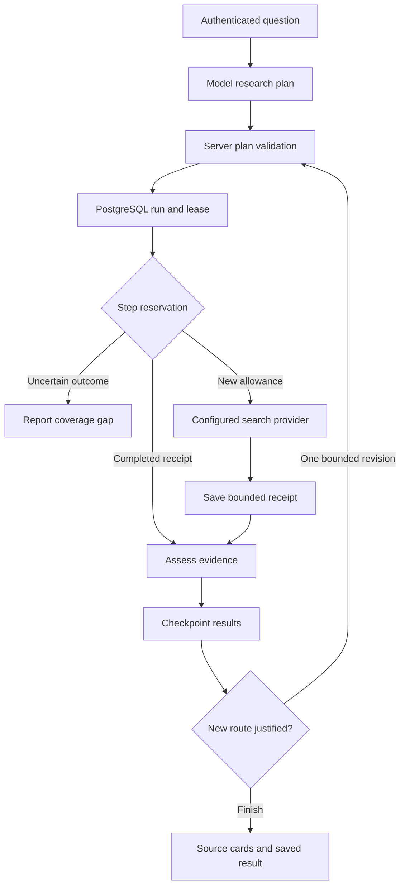

# Pull research backend: architecture and release contract

Date: 23 October 2026. Scope: the product-led buyer-research branch, building on the existing authenticated Vercel/Supabase application. This document describes implemented boundaries separately from proposed extensions. Company valuation does not establish reliability, conversion or market coverage.

## Decision

Keep a modular monolith with a durable PostgreSQL investigation journal. The hosted model plans and revises; server modules validate and execute; PostgreSQL owns research leases, step receipts, budgets and checkpoints. Do not put database mutation authority, server capabilities or provider credentials in model tools. Do not train a new foundation model before there is a measured task and a useful, permissioned outcome dataset.

The initial path is bounded synchronous research. It is not a background task queue or a promise of 1,000 searches in a chat request. Larger investigations need a durable worker and a progress API, preserving the same step-reservation contract. Adding a queue alone would not provide evidence quality or exactly-once provider execution.

## Execution boundaries

The diagram describes one investigation. The implementation uses one configured search provider; it does not simultaneously route across all three providers. Generated hypotheses are research proposals, not assertions of demand.

| Component | Responsibility | Authority boundary |
| --- | --- | --- |
| `server/backend.js` | Verify session/account, enforce AI quota, bind request to sanitized goal, finalize evidence | Existing account guard runs before tools are constructed |
| `server/ai.js` | Bounded planning, optional revision, final summary, preserve cards after model failure | Enabled tool allowlist; no persistence or sending tool is model-accessible |
| `server/intelligence.js` | Enforce fixed product/location, shared source allowance, research permissions, checkpoints | Feature flag and explicit research permission both required |
| `server/buyer-research.js` | Validate hypotheses, execute fair search order, assess snippets, deduplicate, report gaps | Provider endpoint allowlist, quota callback, request deadline, no private-community access |
| `server/research-journal.js` | Reserve/replay steps and save checkpoints | Server-only purpose-specific capability plus owner JWT |
| `database/research-runs.sql` | Durable state, row locks, leases, quota transaction, immutable receipts | RLS, column privileges, private security-definer functions with explicit owner/capability checks |
| `dist/app.js` | Stable ID and brief for the retry button; discard on account change | Account guard prevents late responses from entering another account |
| `dist/intelligence-ui.js` | Display evidence and limitations | Escaped text, safe links, no automatic conversion of source pages into people |

## Journal contract

A run is unique by `(user_id, request_key)`. Its goal hash binds the seller's sanitized question and opted-in context. An existing ID cannot be rebound to a different goal. The first validated research plan is authoritative on recovery; a later model proposal cannot silently replace it.

1. **Start:** an owner/key advisory lock serializes run creation. An active run returns `busy` with no worker lease. A completed run returns its saved result. An expired lease can be resumed with a new token.
2. **Reserve:** lock the run row, verify owner/capability/lease/status/retention, check for a previous step, enforce the investigation cap, and claim the existing daily quota in the same transaction. Steps are keyed by configured provider and normalized query.
3. **Retrieve:** only a new reservation may call the provider. A completed step replays its bounded saved receipt. A reserved or uncertain step is not automatically repeated.
4. **Record:** store only a bounded normalized response or a sanitized failure code. A receipt cannot be overwritten with a different response. Old lease holders cannot write.
5. **Checkpoint:** compare the expected revision before storing consolidated evidence. Finalization clears the lease and completes the run. A model outage can still finalize available source cards.

A crash between external execution and saving a response cannot be resolved with certainty without provider-supported idempotency or reconciliation. Pull conservatively keeps the reservation and reports uncertainty. It does not refund or automatically repeat it. Therefore `requestsUsed` in durable mode counts reserved source allowance, which can exceed confirmed HTTP completions. Provider billing is a separate measurement. AI/model calls are not idempotent under this journal and still consume the existing AI quota on retries.

If a crash occurs before any result checkpoint, recovery replays saved receipts for the original plan. If a checkpoint exists, recovery returns it with partial coverage and stops new automatic research. This preserves known evidence without pretending that every later step was recovered. The browser retry button keeps the same request ID and brief within the current session; reloads and newly submitted questions do not provide persistent client deduplication.

## Limits and isolation

- At most four hypotheses per pass, two queries per hypothesis, eight source reservations per run, twenty displayed sources; lower configured limits still apply.
- At most three hosted-model rounds; one optional evidence-informed revision. Each search pass is limited to sixteen seconds and revision must fit a thirty-five-second investigation window including intervening model time. Individual provider calls have an eight-second timeout; journal RPCs have a three-second timeout. These are component bounds, not a measured end-to-end SLO.
- Lease lifetime: ninety seconds after run acquisition. A worker that exceeds it fails its next database fence. There is no automatic background heartbeat or queue worker in this branch.
- Run plan <=32 KB, provider receipt <=100 KB, snapshot <=250 KB. Provider rows are normalized and truncated before persistence. Original pages are not fetched.
- Owner-only read access excludes worker lease columns. Clients cannot directly create, update or delete runs or read private step/capability tables. Authentication without the server capability cannot reserve or certify evidence.
- New research flags default false. Durable mode fails closed if schema, secret or stable request ID is unavailable. It never silently falls back to unjournaled provider calls.
- Only the existing private-sector source policy applies. Publication dates remain source-asserted. Lifestyle/interest is not personal affordability. No contact or sales outcome is fabricated.

## Configuration and secret provisioning

The non-durable prototype requires `PULL_BUYER_RESEARCH_ENABLED=true`, explicit user research permission, configured AI/search providers, and existing quotas. Durable operation additionally requires the reviewed candidate schema, `PULL_RESEARCH_DURABLE_ENABLED=true`, and server-only `PULL_RESEARCH_SECRET` of at least thirty-two random characters. It is intended for validated staging first. No production schema or configuration was changed for this branch.

The database stores only `SHA256(researchCapability(secret))`, where the server helper defines `researchCapability(secret) = SHA256('pull-research-journal-v1' + NUL + secret)`. Provision the digest into the singleton `pull_private.research_capability` row using an administrator connection; keep the original random secret in the server environment. Never put the secret or bearer capability in SQL committed to git, frontend code, model input, logs, source requests, or PR descriptions. Rotation must coordinate database digest and server configuration; mismatches deliberately stop research. This is the repository's existing purpose-bound server-capability pattern, not a substitute for owner authentication.

`database/research-runs.sql` is a candidate additive schema in the repository's SQL-file convention. It is not recorded as an applied Supabase migration. Rehearse against the deployed PostgreSQL version and existing policies, run database advisors, and generate the managed migration through the project's migration process before release.

## Operational release gates

| Gate | Evidence available in this branch | Still required before durable production enablement |
| --- | --- | --- |
| Application regression | Syntax and full local test suite | Exact PR commit passes CI with lockfile installation |
| SQL ownership and recovery | Actual SQL in isolated PGlite PostgreSQL: RLS, privilege checks, leases, quotas, receipts, replay, HTTP integration | Staging Supabase/PostgREST, database advisors and deployed-version compatibility |
| Concurrency | Row/advisory locks and revision fences exercised through state transitions | Multi-connection tests for competing starts, same-step reservations, shared daily quota and interrupted workers; PGlite's single connection does not prove these races |
| Performance | Component caps and timeout propagation | Staging latency/cost measurements, representative concurrency, provider throttling and database contention |
| Research usefulness | Deterministic classification fixtures, multiple product categories | Human-labelled live samples across locations/languages; separate relevance, current-demand precision, intermediary usefulness and confirmed responses |
| Retention | Thirty-day `retain_until`, no replay or writes after expiry, user deletion cascades | Scheduled physical deletion of expired runs/receipts, verified deletion and backup retention policy; the timestamp alone does not delete data |
| Observability | Run IDs, query traces, usage totals, coverage and saved receipts | Redacted structured metrics/alerts, operational dashboard and incident runbook; no secret-bearing payload logs |
| Recovery | Local crash/replay and stale-worker checks | Backup/restore rehearsal, secret rotation rehearsal, provider outage and server termination tests |

Proposed initial targets for staging evaluation: zero cross-tenant disclosure; no reservation beyond configured run/daily caps; no automatic repeat of uncertain steps; at least 99% of successful research executions deliver either source cards or an explicit empty/partial result. Measure latency percentiles, model tokens, provider allowance, duplicate rate and checkpoint failures before choosing a public availability or completion-time commitment. These are proposed acceptance criteria, not achieved production metrics.

## Next intelligence layers

Original-source verification comes next through authorized, source-specific adapters with SSRF protections, freshness checks and evidence provenance. Entity resolution must establish whether records describe the same buyer without inventing contact details. Qualification needs explicit need, product constraints, geography, timing and an appropriate contact path. Seller-confirmed responses and sales then become an outcome dataset for ranking routes and evaluating whether a second pass improves yield per unit of cost.

For long investigations, introduce asynchronous jobs, a tenant-scoped progress/read API, explicit cancellation and a worker using this same journal. Enforce spend limits before expanding breadth. Only add a separate service or fine-tuned model when measured throughput, reliability, evaluation or cost requires it.

## References reviewed

Official sources reviewed 22–23 October 2026:

- Supabase RLS: https://supabase.com/docs/guides/database/postgres/row-level-security
- Supabase changelog: https://supabase.com/changelog
- PostgreSQL locking clauses: https://www.postgresql.org/docs/current/sql-select.html
- PGlite architecture and single-connection constraint: https://pglite.dev/docs/
- Vercel durable workflow option for a later async path: https://vercel.com/docs/workflows

Local SQL validation uses pinned development-only `@electric-sql/pglite@0.5.11`; production continues to use Supabase. The lockfile and CI installation are committed so these checks run reproducibly.
